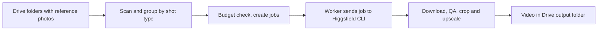

# Video Automation

A small web app that turns product reference photos into short vertical product videos for Zalando listings. Built for the content team, who used to generate every clip by hand.

## Why

For each product we shoot a few reference photos (full body front and back, a close up, a detail shot). Making a video from them meant picking the right images, pasting the right prompt into the generation tool, waiting, downloading, checking the result and filing it. That is fine for one product and painful for fifty. The app scans the product folders in Google Drive, creates one job per product, runs them in the background with retries, checks each result and puts the finished video back into Drive.

## How it works



1. In the frontend you start a Drive scan. `drive_scan.py` reads the folders under `reference-images/` (`oberteil` for tops, `unterteil` for bottoms) and sorts the photos by shot type from the file names (`_full`, `_front`, `_fullback`, `_detail_one`). If a name does not say what the photo shows, `image_classify.py` asks a small Gemini vision model and caches the answer.
2. You preview the scan and commit it. Before any job is created, the spending limits per batch and per month are checked.
3. `worker.py` runs the jobs with a few in parallel, retries temporary errors with a backoff and gives up on permanent ones. Each job calls the Higgsfield CLI through `higgsfield_adapter.py`, using a prompt template for tops or bottoms from `templates.py`.
4. The finished video is downloaded, audio is removed, it is cropped to portrait if needed and upscaled to 1080p if the model delivers less. `qa.py` then checks duration and size with `ffprobe` and makes a thumbnail.
5. For the models that have a dedicated detail shot, `logo_check.py` compares the detail photo with a frame of the video using Gemini, to see whether the real logo is still there. It only reports a status and never blocks a job.
6. The video lands in `output/Oberteil` or `output/Unterteil`. The dashboard shows status, preview and retry buttons.

## Video specification

| Setting | Value |
|---|---|
| Length | 10 seconds |
| Format | 9:16, 1080p |
| Cuts | hard cuts, no camera moves |
| Sound and text | none |
| Models | `kling3_0`, `gemini_omni`, `gemini_omni_flash_1_1` |

Kling 3.0 takes two reference images (front and back) and has its own prompt variants. The Gemini models take up to four.

## Stack

* Backend: FastAPI on Python 3.11, an async worker loop, `ffmpeg` and `ffprobe`
* Frontend: React with Vite
* Database: SQLite locally, Postgres (Neon) when hosted
* Storage: Google Drive, either the Drive desktop folder or the Drive API v3 with a service account
* Generation: Higgsfield CLI, Gemini for image classification and the logo check
* Hosting: Render, see `render.yaml`

## Run it

```bash
python3 -m venv .venv && .venv/bin/pip install -r requirements.txt
./start_backend.sh                     # backend on port 8000
cd frontend && npm install && npm run dev
```

You need a `.env` in the project root (not in git), `ffmpeg` on the path and a working Higgsfield CLI login. `start_backend.sh` sets `DATA_ROOT` to a local synced Drive folder, so change that path for your machine.

Drive layout:

```
reference-images/
  oberteil/ and unterteil/
    <product SKU>/
      <sku>_full.jpg  <sku>_front.jpg  <sku>_fullback.jpg  <sku>_detail_one.jpg
output/
  Oberteil/ and Unterteil/      finished videos
```

Environment variables, names only:

| Variable | Purpose |
|---|---|
| `DATA_ROOT` | Drive folder for local mode |
| `USE_GDRIVE_API` | `true` uses the Drive API instead of a local folder |
| `GDRIVE_KEY_JSON` or `GDRIVE_KEY_PATH` | Service account key |
| `GDRIVE_SHARED_DRIVE_NAME` | Name of the shared drive |
| `DATABASE_URL` | Postgres connection, empty means local SQLite |
| `GEMINI_API_KEY` | Image classification and logo check |
| `PORTAL_USERNAME`, `PORTAL_PASSWORD` | Shared login for the whole app (HTTP Basic) |
| `PROMPT_EDIT_CODE` | Code needed to save prompt changes |
| `MAX_CREDITS_PER_BATCH`, `MAX_CREDITS_PER_MONTH` | Spending limits, 0 turns a limit off |
| `WORKER_CONCURRENCY`, `MAX_RETRIES`, `RETRY_BACKOFF_BASE_SECONDS`, `GENERATE_WAIT_TIMEOUT` | Worker tuning |
| `CREDIT_PRICE_EUR`, `INTERNAL_ROOT`, `QA_DURATION_TOLERANCE_SECONDS` | Optional settings |

On Render the Higgsfield CLI is installed at start time, and its two credential files are copied from Render secret files into `~/.config/higgsfield/`. The steps are in the comments of `render.yaml`.

## Notes

* One click can start many paid jobs, so the budget check runs before any job row exists. The current usage is shown at `GET /budget` and in the dashboard.
* I first tried to fix wrong logos automatically with an ffmpeg overlay. It looked like a pasted sticker, so I removed it and kept only the check.
* Filename matching comes first because it is free. The vision model only runs for photos that have no recognisable name.
* The SQLite file stays out of the synced Drive folder on purpose, because syncing a file that is written constantly causes lock problems.

Built at Smilodox and published with permission. Supplier names, emails and business data were removed or replaced with placeholders.
